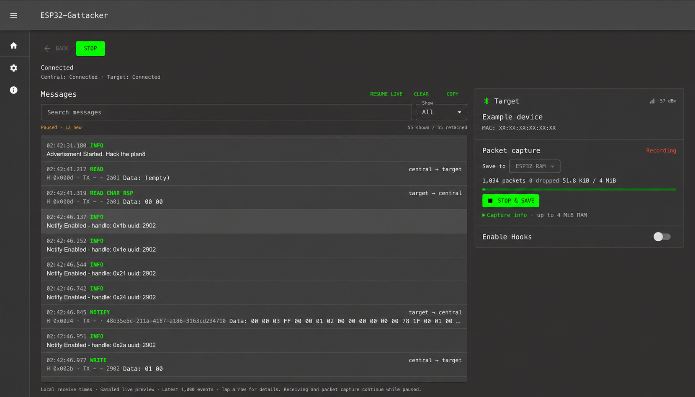

# ESP32-Gattacker

An ESP32 powered implementation of [Gattacker](https://github.com/securing/gattacker) for performing Bluetooth Low Energy MITM (Man-in-the-Middle) attacks.

The ESP32-S3 runs standalone with a web UI for scanning, sessions, hooks, and PCAPNG
capture. It can host its setup AP or join a Wi-Fi network, and offers an
access-key-protected MCP endpoint. The optional
[Flipper Zero companion app](https://github.com/p0px/ESP32-GATTacker-Flipper)
controls the same session over GPIO UART and can save captures to SD.
The Flipper repository currently requires access.



## Install

Use an ESP32-S3 with at least 4 MB of flash. PSRAM is recommended for packet captures.

1. Download a merged `esp-gattacker-*.bin` image from a successful
   [GitHub Actions build](https://github.com/p0px/ESP32-GATTacker/actions).
   Earlier published binaries remain on [GitLab Releases](https://gitlab.com/p0px/esp32-gattacker/-/releases/permalink/latest)
   until the next GitHub release.
2. Flash the image with esptool:

```bash
python -m esptool --chip esp32s3 -p PORT -b 460800 write_flash 0x0 IMAGE.bin
```

> [!WARNING]
> Supports ESP32-S3. This command **will overwrite** your NVS partition, meaning any saved WiFi credentials or settings will be lost.

Replace `PORT` with your serial port (for example, `COM7` or `/dev/ttyUSB0`)
and `IMAGE.bin` with the downloaded filename.

## Instructions
### Connect to WiFi

The default WiFi creds are:

```
ssid: ESP_WIFI
pass: gattattack
```

If these have changed, the current AP name is printed in the serial log at boot.

Once you are connected you can go [http://1.3.3.7](http://1.3.3.7) to access the Web UI.

### Web UI Setup

Open Settings to change the setup AP credentials or scan for a network to join.
The board works without a Flipper; when one is attached, it can approve network
changes from the web UI.

After joining a network, use the station IP shown in Settings. The setup AP
continues to use `1.3.3.7` when enabled. Select a device before starting a
session or PCAPNG capture, and download RAM captures before powering off.
The MCP tool list is in [Doc/mcp-tools.json](Doc/mcp-tools.json).

### Serial

Logs are available over USB serial at `115200` baud.

## Build

From the repository root, build and package the web UI with Node.js 24 and Python:

```powershell
cd UI
npm ci
npm run build
cd ..
python scripts/package_ui.py
```

Build the firmware with Docker and ESP-IDF 5.5.2 (PowerShell):

```powershell
docker run --rm `
  -v "${PWD}:/project" `
  -w /project/Firmware `
  espressif/idf:v5.5.2 `
  sh -lc 'git -C "$IDF_PATH" apply /project/bad_blues.patch && idf.py build'
```

The merged image appears in `Firmware/build/esp-gattacker-*.bin`.
You can also build locally with ESP-IDF 5.5.2 after applying `bad_blues.patch`
to its ESP-IDF checkout; use `idf.py flash` from `Firmware` to preserve NVS.
For different UART pins or PSRAM, run `python scripts/configure_board.py --help`
before building.

GitHub is the primary development repository. [GitHub Actions](https://github.com/p0px/ESP32-GATTacker/actions)
builds pull requests and pushes to `main`, with a merged firmware image in each successful run.
New version tags publish that image to [GitHub Releases](https://github.com/p0px/ESP32-GATTacker/releases).

## Bugs / TODO
* TODO
  * Random WIFI channel/Name
* Future TODO:
  - Replaying
